<picture>
  <source media="(prefers-color-scheme: dark)" srcset="./assets/banner-dark.svg">
  
</picture>

## Sobre mim

Minha formação é em Ciência da Computação. Meu foco atual é **Engenharia de IA**, com Python como linguagem principal para desenvolver aplicações e construir meu portfólio.

## Atividade no GitHub

  <picture>
    <source media="(prefers-color-scheme: dark)" srcset="https://github-profile-summary-cards.vercel.app/api/cards/profile-details?username=rafaelvicentini&amp;theme=github_dark">
    
  </picture>
  <picture>
    <source media="(prefers-color-scheme: dark)" srcset="https://github-profile-summary-cards.vercel.app/api/cards/stats?username=rafaelvicentini&amp;theme=github_dark">
    
  </picture>
  <picture>
    <source media="(prefers-color-scheme: dark)" srcset="https://github-profile-summary-cards.vercel.app/api/cards/repos-per-language?username=rafaelvicentini&amp;theme=github_dark">
    
  </picture>

Calendário registrado em 21/11/2026. Os cartões acima exibem dados do GitHub.

## Projeto em destaque

### [Vitrine & Caixa](https://github.com/rafaelvicentini/-vitrine-caixa-)

Aplicativo para pequenos empreendedores gerenciarem produtos, estoque e vendas e receberem pedidos pelo WhatsApp. Desenvolvi o projeto com **Python, Streamlit e SQLite** como parte de uma atividade de extensão em Cuiabá.

## Contato

